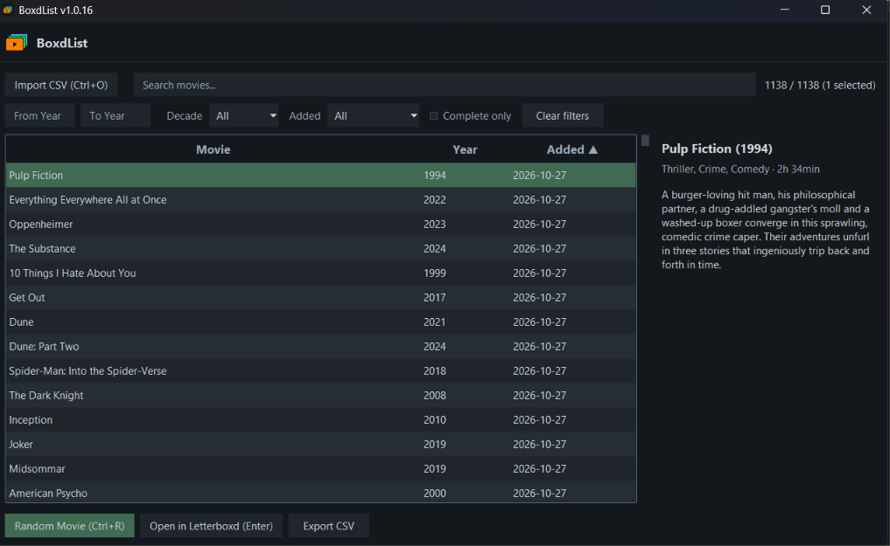

# BoxdList

A desktop app to browse, search, filter and randomly pick from your Letterboxd watchlist.

Import the CSV exported from Letterboxd and see your whole watchlist in one table. Can't decide what to watch? Let it pick one for you.



## Features

- Sortable table with title, year and the date you added each film
- Search by title (ignores case and accents: `amelie` finds *Amélie*)
- Filter by year range or by decade (the dropdown shows how many films each decade has)
- Filter by when you added the film (last 7 days, last 30 days or last year)
- Remembers the window size, its position and the sort order
- Random pick from the films currently shown, never repeating the previous one
- Select a film to see its genres, runtime, synopsis and IMDb rating. After you import, the details are fetched in the background and saved on your computer, so they load instantly next time
- The film poster shows above the synopsis. It grows or shrinks with the window, and it hides when there is no room left, so the text always fits
- Select several films (drag, `Ctrl+click` or `Shift+click`) to see a list that fits the available space: as many films as possible with their details and IMDb rating, or just the names when there is little room
- `Enter` and `Delete` work on all the selected films at once
- Double-click a film (or press `Enter`) to open its Letterboxd page
- Right-click a film to open its page, copy its name or delete it
- Delete a film with the `Delete` key or the right-click menu (it asks first, and the film is also removed from your CSV file)
- Export the films currently shown to a new CSV (handy after filtering)
- Shows how many films are new each time you import an updated CSV
- Remembers the last CSV you imported
- Warns you about malformed rows and films with missing data
- Checks for new versions on startup and offers to update (The update check only runs in the installed version)
- Drag and drop a CSV file onto the window to import it
- Undo the last delete with `Ctrl+Z` (the film goes back to the same place in your CSV)

### Keyboard shortcuts

| Shortcut | Action |
| --- | --- |
| `Ctrl+O` | Import a CSV |
| `Ctrl+F` | Jump to the search box |
| `Ctrl+R` | Pick a random film |
| `Enter` | Open the selected film on Letterboxd |
| `Delete` | Delete the selected film |
| `Ctrl+Z` | Undo the last delete |
| `Esc` | Deselect the film and leave the search box |
| `Ctrl+Backspace` | Clear all filters |

## Movie details

When you select a film, BoxdList shows its poster, genres, runtime and synopsis. The data comes from [TMDB](https://www.themoviedb.org/).

After you import a CSV, the app fetches the details of every film in the background and shows the progress at the top right. The details are saved in `data/details_cache.json` next to the app, so the next time they load without internet and only new films are fetched. Films that TMDB does not know are saved too, and asked again after 5 days (and once when you update the app), in case TMDB adds them later. To start over, close the app and delete that file. Details saved by older versions are fetched again once, to get the IMDb id and the poster.

Only the address of the poster is saved in that file. The image itself is downloaded when you select the film, and it is kept in memory until you close the app, so selecting the same film again is instant. Films that TMDB has no poster for show the details as usual, without an image.

Letterboxd also lists TV series. For those, BoxdList shows the genres and the synopsis, but no runtime. Some entries may show "No details found", for example episodes or titles that TMDB lists with a different year.

The app does not talk to TMDB directly. It asks a small proxy ([boxdlist-proxy](https://github.com/goncaloo07/boxdlist-proxy)), which keeps the TMDB API key private. Only the title and the year of the film are sent. The poster is downloaded straight from TMDB's image server, without the proxy. Without an internet connection the app works as before: the details already saved are shown, and the panel says the others could not be loaded.

## IMDb ratings

The rating and the number of votes come from the [IMDb datasets](https://developer.imdb.com/non-commercial-datasets/). The proxy tells the app the IMDb id of each film (through TMDB), and the app looks that id up in IMDb's `title.ratings.tsv.gz` file.

When the details are ready, BoxdList downloads that file (a few MB), keeps only the ratings of the films in your watchlist and deletes it, so the big file never stays on your computer. The ratings are saved in `data/ratings_cache.json` and downloaded again when they are 5 days old, or when your list has films that were never looked up. To start over, close the app and delete that file.

Films that have no IMDb id on TMDB, or no rating yet, are shown without one. Without an internet connection the saved ratings are still shown. The download sends nothing about your films.

## Getting your watchlist from Letterboxd

There are two ways to get the CSV file:

**Option 1: export the watchlist directly**

1. On Letterboxd, open your **Watchlist** page.
2. Use **Export watchlist** to download the CSV.

**Option 2: export all your data**

1. Go to **Settings → Import & Export** and choose **Export your data**.
2. Unzip the file you receive. The one you need is `watchlist.csv`.

Then, in BoxdList, click **Import CSV** (or press `Ctrl+O`) and select the file, or just drag the CSV onto the window.

> Deleting a film in BoxdList edits the CSV file you imported. Your Letterboxd watchlist online is not changed.

## Download

Grab `BoxdListSetup.exe` from the [Releases](../../releases) page and run it. After installing, press the Windows key and type "BoxdList" to open the app.

> Windows SmartScreen may warn you because the installer is not signed. Click **More info** and then **Run anyway**.

## Run from source

Requires Python 3.10 or newer. Install the dependencies first:

```
pip install -r requirements.txt
python boxdlist.py
```

On Linux you may need Tkinter: `sudo apt install python3-tk`.

## Run the tests

```
pip install -r requirements.txt
python -m pytest
```

## Build the installer (Windows only)

Requires [Inno Setup 7](https://jrsoftware.org/isinfo.php) and PyInstaller (`pip install pyinstaller`).

Run:

```
python build.py
```

The script asks which version to build (press Enter to keep the current one), runs the tests, writes the version into `APP_VERSION` in `boxdlist.py`, builds the app and creates `installer_output/BoxdListSetup.exe`. It looks for `ISCC.exe` in your PATH first, then at `ISCC_PATH` in `build.py`, so you may need to change that path depending on where Inno Setup is installed.

## Publish a release

Requires the [GitHub CLI](https://cli.github.com/) (`gh`), logged in with `gh auth login`.

After building, commit the changes and run:

```
python release.py
```

It asks if you want to push to GitHub, and then if you want to create a release. For the release it asks for a description, shows a summary and asks for a final confirmation. The release is titled `BoxdList vX.Y.Z`, uses the version from `APP_VERSION` as the tag and attaches `BoxdListSetup.exe`. Releases can only be created from the `main` branch.

## Disclaimer

BoxdList is an independent project and is not affiliated with, endorsed by or connected to Letterboxd. Letterboxd is a trademark of its respective owner.

This product uses the TMDB API but is not endorsed or certified by TMDB.

Ratings come from the IMDb non-commercial datasets and are used for personal, non-commercial purposes only. Information courtesy of IMDb (https://www.imdb.com). BoxdList is not affiliated with or endorsed by IMDb. The MIT license covers the code only, not the IMDb data.

## License

[MIT](LICENSE.md)