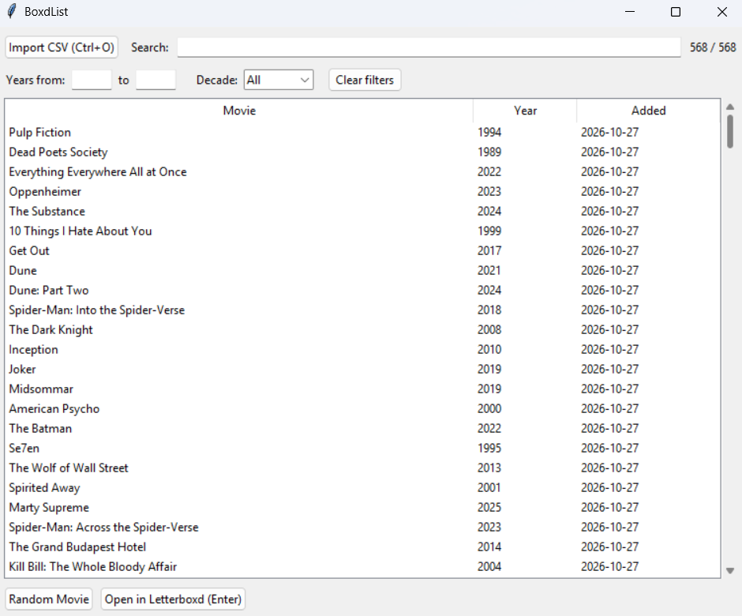

# BoxdList

A desktop app to browse, search, filter and randomly pick from your Letterboxd watchlist.

Import the CSV exported from Letterboxd and see your whole watchlist in one table. Can't decide what to watch? Let it pick one for you.



## Features

- Sortable table with title, year and the date you added each film
- Search by title (ignores case and accents: `amelie` finds *Amélie*)
- Filter by year range or by decade
- Random pick from the films currently shown, never repeating the previous one
- Double-click a film (or press `Enter`) to open its Letterboxd page
- Remembers the last CSV you imported
- Warns you about malformed rows and films with missing data

## Getting your watchlist from Letterboxd

There are two ways to get the CSV file:

**Option 1: export the watchlist directly**

1. On Letterboxd, open your **Watchlist** page.
2. Use **Export watchlist** to download the CSV.

**Option 2: export all your data**

1. Go to **Settings → Import & Export** and choose **Export your data**.
2. Unzip the file you receive. The one you need is `watchlist.csv`.

Then, in BoxdList, click **Import CSV** (or press `Ctrl+O`) and select the file.

## Download

Grab the latest build from the [Releases](../../releases) page, unzip it and run `BoxdList.exe`.

> Windows SmartScreen may warn you because the executable is not signed. Click **More info** and then **Run anyway**.

## Run from source

Requires Python 3.10 or newer. The app only uses the standard library, so there is nothing to install.

```
python boxdlist.py
```

On Linux you may need Tkinter: `sudo apt install python3-tk`.

## Run the tests

```
pip install -r requirements.txt
python -m pytest
```

## Build the executable

```
pip install pyinstaller
pyinstaller --windowed --name BoxdList --icon assets/boxdlist.ico --add-data "assets/boxdlist.ico;assets" boxdlist.py
```

The result is in `dist/BoxdList/`.

The `--add-data` part copies the icon into the build so the window and taskbar can show it. On Linux and macOS, use `:` instead of `;` as the separator.

## Disclaimer

BoxdList is an independent project and is not affiliated with, endorsed by or connected to Letterboxd. Letterboxd is a trademark of its respective owner.

## License

[MIT](LICENSE.md)