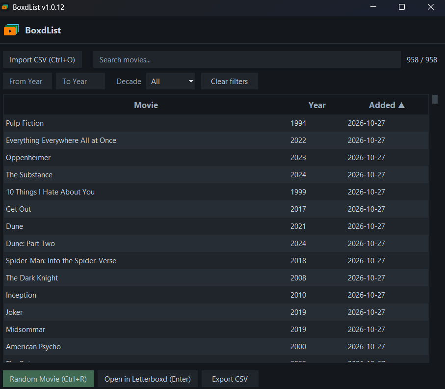

# BoxdList

A desktop app to browse, search, filter and randomly pick from your Letterboxd watchlist.

Import the CSV exported from Letterboxd and see your whole watchlist in one table. Can't decide what to watch? Let it pick one for you.



## Features

- Sortable table with title, year and the date you added each film
- Search by title (ignores case and accents: `amelie` finds *Amélie*)
- Filter by year range or by decade
- Random pick from the films currently shown, never repeating the previous one
- Double-click a film (or press `Enter`) to open its Letterboxd page
- Right-click a film to open its page, copy its name or delete it
- Delete a film with the `Delete` key or the right-click menu (it asks first, and the film is also removed from your CSV file)
- Export the films currently shown to a new CSV (handy after filtering)
- Shows how many films are new each time you import an updated CSV
- Remembers the last CSV you imported
- Warns you about malformed rows and films with missing data
- Checks for new versions on startup and offers to update (The update check only runs in the installed version)
- Drag and drop a CSV file onto the window to import it

### Keyboard shortcuts

| Shortcut | Action |
| --- | --- |
| `Ctrl+O` | Import a CSV |
| `Ctrl+F` | Jump to the search box |
| `Ctrl+R` | Pick a random film |
| `Enter` | Open the selected film on Letterboxd |
| `Delete` | Delete the selected film |

## Getting your watchlist from Letterboxd

There are two ways to get the CSV file:

**Option 1: export the watchlist directly**

1. On Letterboxd, open your **Watchlist** page.
2. Use **Export watchlist** to download the CSV.

**Option 2: export all your data**

1. Go to **Settings → Import & Export** and choose **Export your data**.
2. Unzip the file you receive. The one you need is `watchlist.csv`.

Then, in BoxdList, click **Import CSV** (or press `Ctrl+O`) and select the file, or just drag the CSV onto the window.

> Deleting a film in BoxdList edits the CSV file you imported. Your Letterboxd watchlist online is not changed.

## Download

Grab `BoxdListSetup.exe` from the [Releases](../../releases) page and run it. After installing, press the Windows key and type "BoxdList" to open the app.

> Windows SmartScreen may warn you because the installer is not signed. Click **More info** and then **Run anyway**.

## Run from source

Requires Python 3.10 or newer. Install the dependencies first:

```
pip install -r requirements.txt
python boxdlist.py
```

On Linux you may need Tkinter: `sudo apt install python3-tk`.

## Run the tests

```
pip install -r requirements.txt
python -m pytest
```

## Build the installer (Windows only)

Requires [Inno Setup 7](https://jrsoftware.org/isinfo.php) and PyInstaller (`pip install pyinstaller`).

Run:

```
python build.py
```

The script asks which version to build (press Enter to keep the current one), runs the tests, writes the version into `APP_VERSION` in `boxdlist.py`, builds the app and creates `installer_output/BoxdListSetup.exe`. It looks for `ISCC.exe` in your PATH first, then at `ISCC_PATH` in `build.py`, so you may need to change that path depending on where Inno Setup is installed.

## Publish a release

Requires the [GitHub CLI](https://cli.github.com/) (`gh`), logged in with `gh auth login`.

After building, commit the changes and run:

```
python release.py
```

It asks if you want to push to GitHub, and then if you want to create a release. For the release it asks for a description, shows a summary and asks for a final confirmation. The release is titled `BoxdList vX.Y.Z`, uses the version from `APP_VERSION` as the tag and attaches `BoxdListSetup.exe`. Releases can only be created from the `main` branch.

## Disclaimer

BoxdList is an independent project and is not affiliated with, endorsed by or connected to Letterboxd. Letterboxd is a trademark of its respective owner.

## License

[MIT](LICENSE.md)